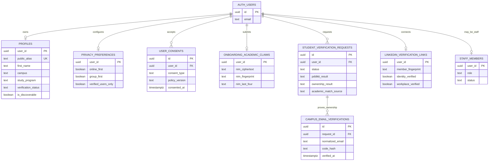
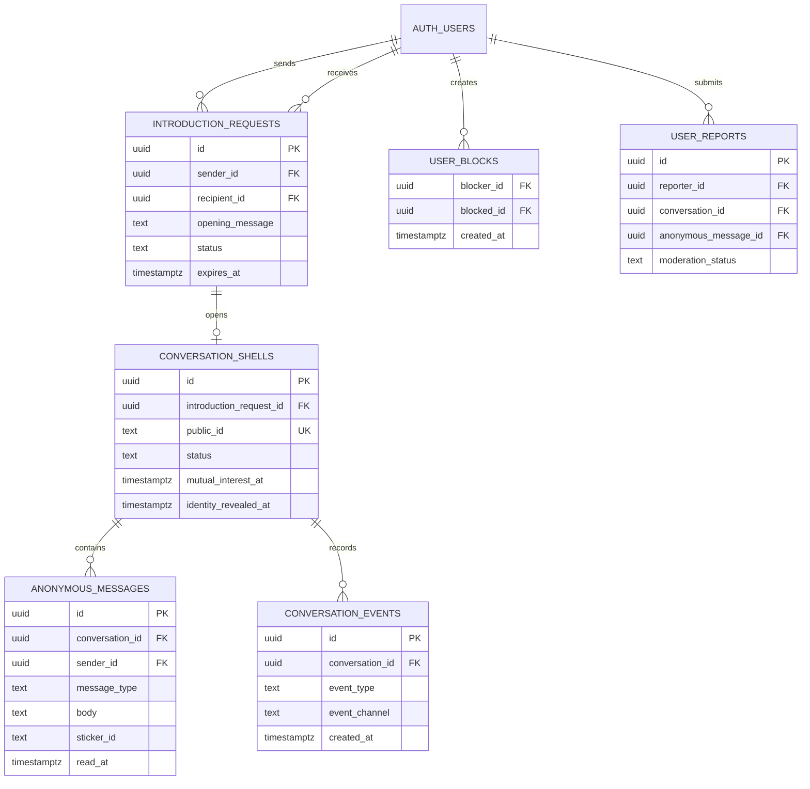
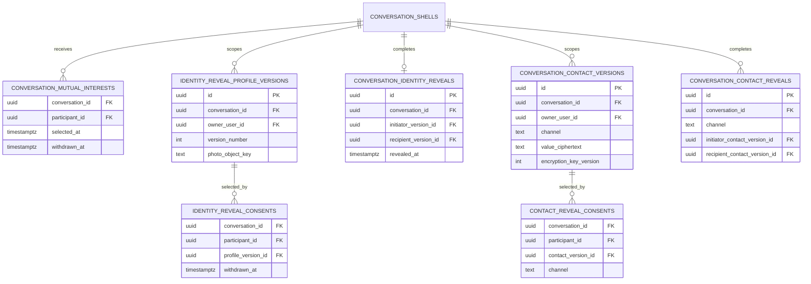
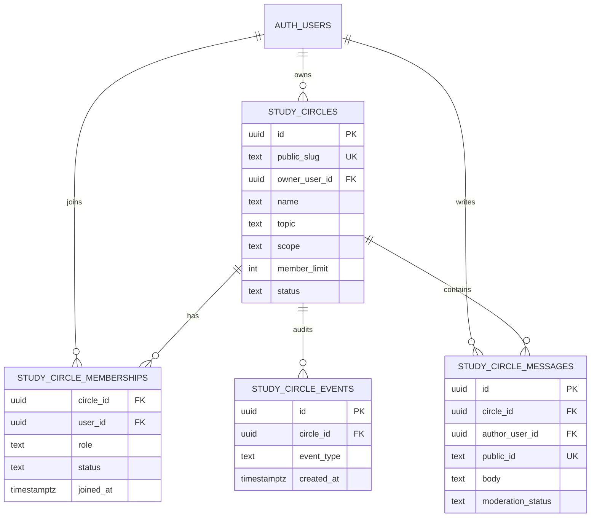
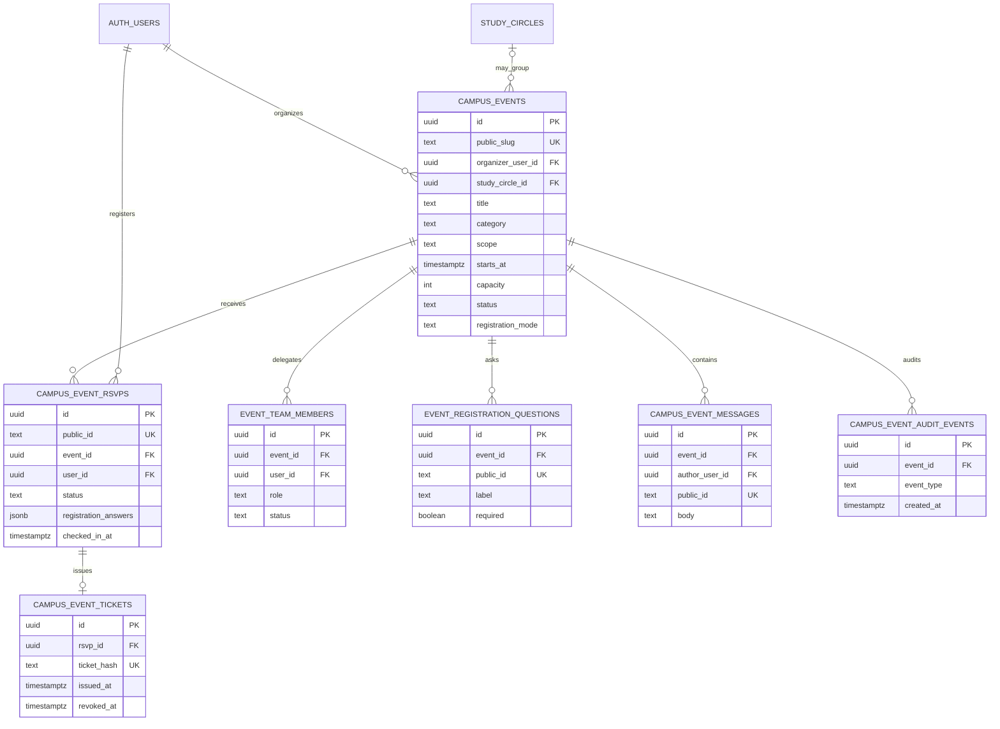
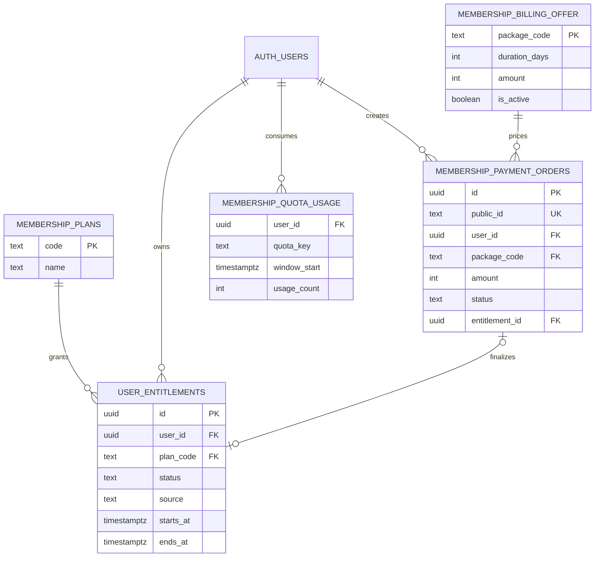
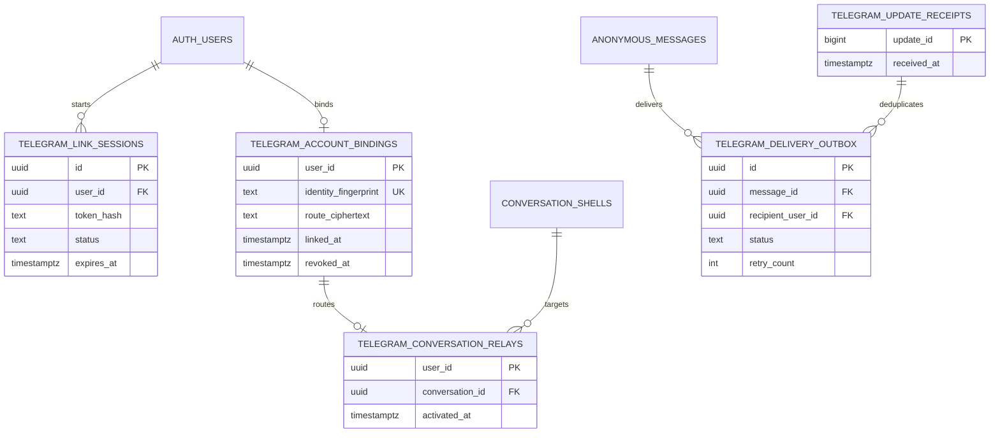

# StudyDate ID — Entity Relationship Diagram

> Updated: 7 October 2026

This document is a readable logical map of the StudyDate ID data model. It does not replace the exact SQL contract.

Sources of truth:

1. `supabase/migrations/` for tables, constraints, functions, RLS, and grants;
2. [SCHEMA.md](./SCHEMA.md) for detailed explanations and rollout notes;
3. this document for understanding relationships between product domains.

A table shown here may be repository-implemented without being active in production. Always verify the remote migration state before calling a capability live.

## 1. Identity, onboarding, and verification



Notes:

- `AUTH_USERS` represents Supabase `auth.users`.
- `profiles.first_name` is private application data and is not part of the People Discovery projection.
- NIM and legal-name claims use encrypted or fingerprinted storage where defined by the migrations.
- LinkedIn is an optional trust layer. It does not grant the student badge.
- Staff authorization requires trusted Auth metadata and an active `staff_members` row.
- `early_access_waitlist.claimed_user_id` may reference `auth.users.id`, but an Early Access entry is not a StudyDate account or a student verification.

## 2. Introduction and anonymous conversation



Main lifecycle:

```text
pending introduction
→ accepted introduction
→ awaiting_chat conversation
→ active conversation
→ mutual interest
→ identity reveal
→ contact reveal per channel
```

The lifecycle is progressive. A completed step does not silently grant the next step.

## 3. Mutual Interest, Identity Reveal, and Contact Reveal



Privacy rules:

- Mutual Interest selections are private until both participants select them.
- Identity versions are scoped to one conversation and cannot be reused as global identity proof.
- Contact values are encrypted and scoped to one conversation and one channel.
- Telegram, Instagram, and LinkedIn complete independently.
- Blocking hides counterpart reveal data on future requests but cannot erase information already seen or captured.

## 4. Study Circles



Joining a Circle does not create an introduction, private conversation, Identity Reveal, or Contact Reveal.

## 5. Campus Events



Event registration, attendance, and check-in do not expose a participant's legal identity or contacts to other participants. Organizer and team projections remain limited to operational data allowed by the migrations.

## 6. Membership and billing



Payment availability and database deployment are different states. The checkout kill switch and production payment audit still determine whether checkout may be offered.

## 7. Telegram Companion



Telegram is a transport for an existing StudyDate Anonymous Chat. It must not become a second identity system or reveal Telegram metadata to the other participant.

## 8. Notifications, moderation, and account lifecycle

Core supporting tables include:

| Domain | Main tables | Purpose |
|---|---|---|
| Notifications | `user_notifications`, notification preferences | Recipient-scoped in-app alerts without private message content |
| Safety | `user_blocks`, `user_reports`, `moderation_report_events` | Block, report, and sanitized moderation lifecycle |
| Staff | `staff_members`, `staff_role_events` | Trusted role, capabilities, and append-only role audit |
| Account deletion | `account_deletion_requests`, `account_privacy_policy`, `account_deletion_audit_events` | Privacy lock, bounded cleanup, retention, and sanitized audit |
| Rate limits | Feature-specific rate-limit tables | Durable abuse and quota boundaries |
| Verification audit | `verification_events` | Sanitized verification lifecycle without evidence payload |
| Reveal media cleanup | `identity_reveal_photo_cleanup_queue` | Retry-safe cleanup of private reveal photos |

These supporting entities are intentionally not connected into every diagram. Their foreign keys and security rules must be checked in the exact migration before implementation work.

## 9. Data exposure zones

| Zone | Examples | Client access rule |
|---|---|---|
| Public or anonymous-safe | landing content, opaque public slugs, bounded Event metadata | Only explicitly approved public output |
| Authenticated safe projection | People cards, Circle members, Event attendees, notification rows | RPC projection with no raw UUID or private data |
| Participant-private | introductions, Anonymous Chat, reveal state, meeting plans | Only eligible participants |
| User-private | preferences, verification status, LinkedIn connection status, membership | Only the owning user through approved RPC or RLS |
| Staff-restricted | verification evidence, moderation queue, account support | Capability-based and audited |
| Service-only | encryption operations, provider callbacks, payment finalization, deletion workers | Server or service-role only |

## 10. Maintenance rule

Update this file when a change adds, removes, or materially changes a core relationship. Also update:

- [SCHEMA.md](./SCHEMA.md) for exact entity behavior;
- [PRD.md](./PRD.md) for product behavior;
- [ARCHITECTURE.md](./ARCHITECTURE.md) for service boundaries;
- tests and migration documentation for rollout evidence.

Do not update the ERD first and treat it as database implementation. The migration, security policy, server validation, tests, and controlled rollout must exist separately.
